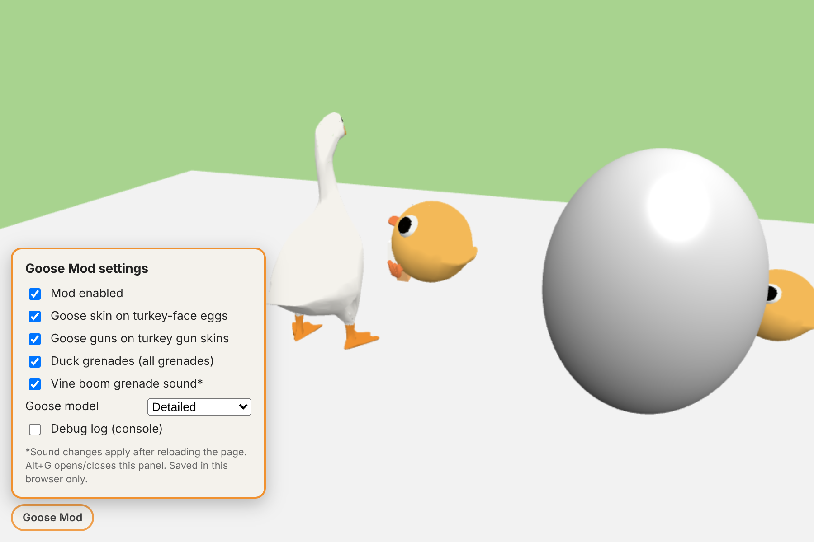

# GOFFY GOBER SHELL EATER MOD

A cosmetic Shell Shockers userscript:

- **Goose skin:** eggs wearing the **turkey face** become an Untitled-Goose-Game-style goose (white, orange beak and feet, black eyes), in matches **and in the menu/shop egg preview**. The egg is hidden and the goose is sized to the egg.
- **Goose guns:** guns with a **turkey skin** become a goose blaster.
- **Duck grenades:** **every** grenade (whatever skin you have) becomes a Fall Guys duck, in your hand and in flight.
- **Vine boom:** the grenade explosion sound is replaced with the vine boom.
- Every feature has its own on/off switch in the in-game **Goose Mod** settings panel.

Purely visual/audio, and only on your screen: nobody else sees or hears the change.



> Status: **v0.6.1.** Tested in a real browser against mock scenes that hide Babylon.js the way Shell Shockers does (Babylon 4.2 and 9.x), **not yet confirmed in a live Shell Shockers match.**
> Finding the turkey face, turkey gun skins, grenades and the explosion sound is a best-effort name match (see *Tweaking*).

## Install

1. Install a userscript manager such as [Tampermonkey](https://www.tampermonkey.net/).
2. Open `shell-goose-mod.user.js` in this repo and click **Raw**. Tampermonkey offers to install it. (Or make a new script and paste the file in.)
3. Go to [shellshock.io](https://shellshock.io). Open the settings (**Alt+G**) and check the status line at the top.

## Settings

Press **Alt+G**, or click the small **Goose Mod** button in the bottom-left corner.

| Setting | What it does |
| --- | --- |
| Mod enabled | Master on/off switch. Off restores everything right away. |
| Goose skin on turkey-face eggs | Swap turkey-face eggs for the goose. |
| Goose guns on turkey gun skins | Swap turkey-skinned guns for the goose blaster. |
| Duck grenades (all grenades) | Swap every grenade for the Fall Guys duck. |
| Vine boom grenade sound | Replace the explosion sound. **Reload the page** after changing this one. |
| Goose size | How big the goose is. At 100% the top of its head is just above the egg it replaces. Updates live. |
| Turn goose around | Flips the goose 180° if it faces the wrong way. |
| Duck grenade size | How big the duck grenades are. Updates live. |
| Goose model | **Detailed** (~4,000 triangles) or **Simple** (~1,000 triangles, for slow PCs/Chromebooks). |
| Debug log | Prints what the mod finds and swaps to the browser console (F12). |

Settings are saved in your browser only.

### Status line

The top of the panel says what the mod is doing:

| Status | Meaning |
| --- | --- |
| *Active in N scene(s): …* | Working. The counts show how many eggs, guns and grenades are swapped right now. |
| *Waiting for the game's 3D scene…* | The mod can't find the game's 3D scene. If it stays like this in a match, the game probably updated; report it. |
| *Found N 3D scene(s), getting ready…* | The scene was found but the mod hasn't been able to set up its materials yet. If it stays like this, report it. |
| No **Goose Mod** button at all | The script isn't running on this site. Check Tampermonkey is enabled for it, and that the site address matches the `@match` lines at the top of the script. |

## Tweaking (`CONFIG` at the top of the script)

| Option | What it does |
| --- | --- |
| `facePattern` | Regex matching the turkey item's mesh/material/texture name. |
| `gunWords` | Words that mark a mesh as a gun. A mesh matching `facePattern` **and** `gunWords` is a turkey gun skin. |
| `grenadePattern` | Regex matching grenade meshes. |
| `grenadeSoundPattern` | Regex matching the explosion sound file's URL. |
| `gooseColors` | Body / feet / beak / eyes colours. |
| `gooseScale`, `gooseOffset`, `gooseRotationY` | Extra size multiplier, position nudge and facing of the goose (the panel's size slider and turn-around switch are easier). |
| `gooseHeightVsEgg` | Goose height compared with the egg at 100% size (default `1.08`: head just above the egg). |
| `maxEggSize` | When the egg isn't attached to the face, the mod looks for it by position and ignores anything bigger than this. |
| `gunScale`, `gunRotation` | Size and direction of the goose gun (it sizes itself to the real gun automatically). |
| `grenadeScale`, `grenadeRotationY` | Size and facing of the duck grenade. |

If the status says *Active* but something isn't swapped: open the browser console (F12) and type `gooseModNames()`. It lists every mesh/material name the game is using right now, so you can see what the turkey face, gun skins and grenades are really called and adjust the patterns. Turning on **Debug log** also prints each swap and swapped sound URL.

If the egg still shows under the goose, type `gooseModInspect()` in the console: it shows, for each turkey face, which egg the mod matched it to and how tall the egg and goose are. Paste that to the mod author.

## Using different models or sounds

Models and the sound are embedded in the script so it never downloads anything while you play.

```bash
cd tools && npm install
```

Swap the goose (turkey-face eggs) or the grenade duck. The number is the triangle budget; the tool simplifies to it so the game doesn't lag:

```bash
node build-model.mjs path/to/model.glb goose 4000
```

```bash
node build-model.mjs path/to/model.glb grenade 3000
```

`.usdz` models (e.g. from Apple/Sketchfab) need converting to `.glb` first. This bakes their textures into vertex colours:

```bash
pip install usd-core pillow
```

```bash
python usd_to_glb.py model.usdz model.glb
```

Swap the explosion sound (MP3, under 200 KB):

```bash
node embed-sound.mjs path/to/sound.mp3
```

For `goose` models, part colours come from material names `body`, `feet`, `beak` and `eyes` (anything else is coloured as body). `grenade` models keep their own colours.

## Credits and licensing

The goose is a fan model of the goose from *Untitled Goose Game* (House House), the duck is a fan model of the *Fall Guys* duck (Mediatonic/Epic Games), and the vine boom is a meme sound. They are included for personal, non-commercial fun. If this repo is public, check the licences of the original uploads before sharing it widely.

## Not included

No hitbox overlays or StateFarmClient integration. Those would show other players' positions, which is cheating.
